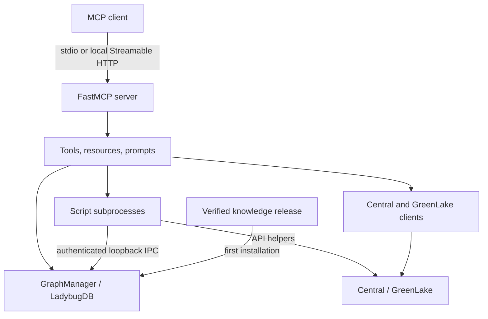

# Technical overview

[Documentation index](README.md) · [Development](DEVELOPMENT.md)

NetOps API Navigator combines a local API knowledge graph with authenticated
network access. This document explains the architecture of the current source.
For settings and callable interfaces, use the [configuration reference](configuration.md)
and [MCP reference](mcp-reference.md).

## Architecture

The server owns the graph and coordinates its access. API discovery uses local
knowledge; a live API call is a separate action. MCP resources expose schema and
catalog context, while prompts provide task guidance to the client.

## Startup and ownership

[server.py](../src/netops_api_navigator/server.py) constructs a `ServerRuntime`
that owns the clients, graph, optional script IPC server, and background seeds:

1. Parse CLI options and load environment-backed settings. Workshop forces
   read-only cloud access and disables optional compiler/hydration tools.
2. Reject partial Central credentials. Validate a configured Central client;
   otherwise select discovery-only mode.
3. Install a verified knowledge release for a new graph, check any explicit pin,
   and obtain sidecars when compiler tools are enabled.
4. Open the graph, initialize its schema/indexes, and check the knowledge schema
   version. An incompatible or unreadable graph stops startup.
5. Validate GreenLake when applicable. Its failure disables GreenLake access
   without preventing a valid Central connection.
6. Register the profile's tools and resources, prepare script support where
   permitted, and launch eligible automatic seeds in the background.
7. Serve MCP over stdio or the authenticated loopback HTTP transport.

`doctor` constructs the runtime without starting background seeds or entering
the MCP serving loop, emits a status report, and closes it. `--skip-credentials`
skips authentication checks; it still opens the local graph and may download
knowledge/extensions. It is not a read-only database inspection command.

One process owns a runtime graph. GraphManager serializes access and manages
connections within that owner. Script subprocesses use IPC instead of opening
the database file. Several independent stdio servers cannot share a graph;
the [shared local HTTP service](getting-started.md#multiple-local-clients) lets
multiple client sessions use one owner.

On stdio EOF or service termination, runtime cleanup stops seed work, drains IPC,
closes API clients, and releases the graph. Native statements already running
must finish; forced termination can bypass normal cleanup. Corruption and
ownership errors do not trigger deletion of database files or sidecars. See the
[restart investigation](graph-restart-investigation.md) for the failure analysis.

## Knowledge and runtime data

The graph has distinct kinds of data:

| Layer | Examples | Origin |
|---|---|---|
| API/documentation knowledge | Endpoints, parameters, schemas, properties, CLI/YANG links, docs, bundled scripts | Build-time ingestion |
| Network domain | Organizations, sites, devices, groups, topology links | Connected seed scripts |
| Optional observations | Hydration runs, observed objects/fields, facts, generic entities | Opt-in runtime hydration |

The default knowledge projection is `legacy`. The optional `v2` projection and
AST sidecar support compiler provenance and diagnostics. Both use the focused
graph tools for normal API discovery. Selecting a projection is independent of
enabling optional diagnostic tools.

An installed graph also contains local state, so a newer knowledge release does
not overwrite it automatically. The manifest records the artifact identity and
schema version. Storage-format compatibility is a separate concern from that
knowledge schema version. See [knowledge lifecycle](configuration.md#knowledge-database-lifecycle)
and [engine upgrades](ladybug-extension-upgrade.md).

The graph schema is defined in [graph/schema.py](../src/netops_api_navigator/graph/schema.py).
The `graph://schema` resource reports the actual loaded tables, relationships,
and counts. Use that resource instead of relying on a static entity count or
assuming all optional layers are populated.

Schema ingestion preserves composition and reference relationships rather than
flattening every nested schema into endpoint payloads. Properties can be followed
through components and composition edges; raw source is available for detail
that structured traversal does not expose. Ingestion invariants check the
persisted result. Their executable definitions are in
[graph/invariants.py](../src/netops_api_navigator/graph/invariants.py).

## Script execution

The full profile exposes a script library. Discovery mode can store and inspect
scripts; execution requires a connected Central client. Workshop omits
user-authored script tools and only runs two trusted package seeds for topology.

The runtime copies `central_helpers.py` and `_http_core.py` into the library.
Scripts import `api`, `glp`, and `graph` helpers for authenticated HTTP requests,
pagination, and local graph operations. The authoritative authoring guide is
available to MCP clients as `docs://script-writing-guide`; bundled examples live
in [seeds/](../src/netops_api_navigator/seeds/).

[tools/execution.py](../src/netops_api_navigator/tools/execution.py) runs scripts in
subprocesses with parameters and an injected environment, bounds runtime/output,
and records results in script metadata. Graph access uses newline-delimited JSON
over an ephemeral loopback TCP port with a per-start capability token. This avoids
competing database owners and lets the server serialize graph operations.

Network read-only mode is enforced through API tools/helpers and the script
runtime's HTTP guard. It does not remove local writes or sandbox arbitrary Python
code. The workshop profile removes user execution rather than treating it as safe
because HTTP writes are blocked.

## Build and publication

The build pipeline retrieves Central and GreenLake OpenAPI sources and supporting
documentation, normalizes source documents, populates graph projections and seed
metadata, builds indexes, and checks ingestion/compilation health. Release
artifacts carry the manifest and source/provenance data needed by the runtime.

Central OpenAPI exports are a separate consumer of the source cache. They produce
self-contained OpenAPI 3.1 JSON with validation and correction records; they are
not a dump of the runtime graph. See [export implementation](openapi-export.md).

[Maintenance](maintenance.md) owns workflow schedules, release gates, and alert
handling. [Development](DEVELOPMENT.md) owns local setup, graph conventions, and
verification commands.

## Source map

| Component | Location |
|---|---|
| Runtime construction, CLI, and shutdown | [server.py](../src/netops_api_navigator/server.py) |
| Environment-backed configuration | [config.py](../src/netops_api_navigator/config.py) |
| Shared local MCP HTTP service | [http_transport.py](../src/netops_api_navigator/http_transport.py) |
| Cloud authentication and requests | [central_client.py](../src/netops_api_navigator/central_client.py) |
| Knowledge artifact installation | [knowledge_db.py](../src/netops_api_navigator/knowledge_db.py) |
| Graph ownership, schema, IPC, and invariants | [graph/](../src/netops_api_navigator/graph/) |
| MCP input schemas and tool behavior | [tools/](../src/netops_api_navigator/tools/) |
| Client-facing resources and guidance | [resources/](../src/netops_api_navigator/resources/), [instructions.py](../src/netops_api_navigator/instructions.py) |
| Compiler artifacts and provenance | [compiler/](../src/netops_api_navigator/compiler/) |
| Build, smoke, and publication helpers | [scripts/](../scripts/) |

Design rationale is recorded in [architecture decisions](adr/). Proposals and
roadmaps are linked separately from current user documentation in the
[documentation index](README.md#design-and-investigation-records).
